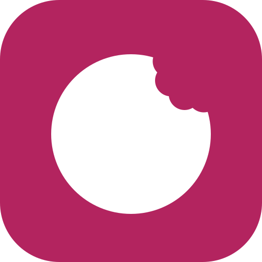

<h1 align="center">BISS</h1>

<b>B</b>arcode · <b>I</b>mage · <b>S</b>can · <b>S</b>ave

Selbst gehostete Ernährungs-Erfassung für den persönlichen Gebrauch. Bekanntes Essen kostet einen Tap, ein neues Produkt höchstens zwei Bestätigungen: Barcode scannen, Nährwert-Etikett fotografieren, fertig. Die eigene Lebensmitteldatenbank wächst mit der Nutzung.

Die App zeigt nur den heutigen Tag (kcal, Eiweiß, Kohlenhydrate, Fett). Auswertungen laufen extern über die API und einen MCP-Server.

## Stack

- **Backend:** FastAPI, PostgreSQL mit pg_trgm, Suche über eigene DB, BLS 4.0 und Open Food Facts
- **Frontend:** Next.js, shadcn/ui, Tailwind als PWA, Barcode-Erkennung mit ZXing
- **Erfassung per LLM:** Nährwert-Etiketten werden per Vision-Modell ausgelesen und im Code plausibilisiert
- **Betrieb:** Docker Compose, Web auf Port 2477, API auf 2478

## Status

Phase 1: Spezifikation steht in [`docs/SPEC.md`](docs/SPEC.md), Entscheidungen in [`docs/adr/`](docs/adr/). Der Design-Prototyp liegt unter [`docs/design/prototype.html`](docs/design/prototype.html).

## Lizenz

Code unter [MIT](LICENSE). Nährwertdaten: Bundeslebensmittelschlüssel (BLS) 4.0, Max Rubner-Institut, CC BY 4.0; Produktdaten zur Laufzeit von Open Food Facts (ODbL).
